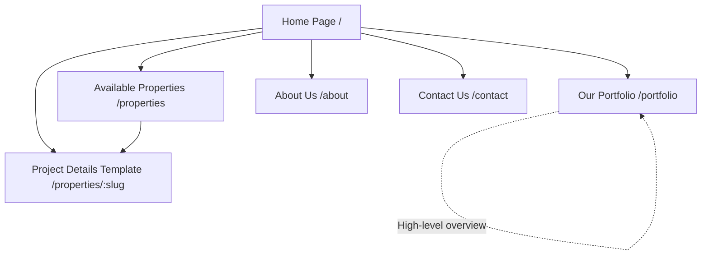
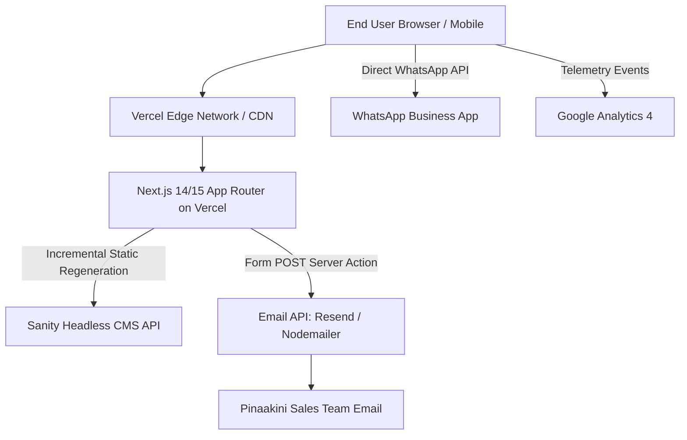
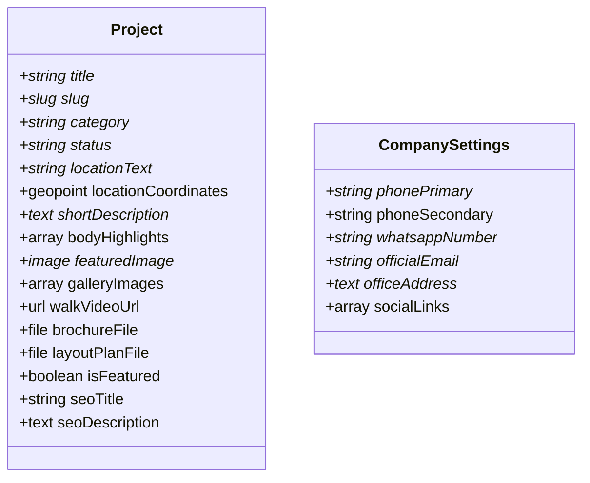
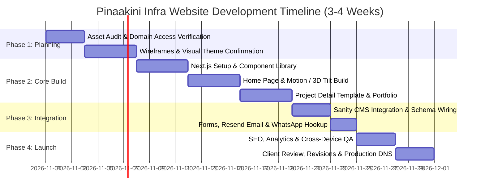

# Product Requirements Document (PRD)
## Pinaakini Infra Private Limited — Corporate & Real Estate Showcase Platform

**Document Version:** 1.0  
**Status:** Approved for Implementation / Baseline Scope  
**Author:** Product & Technical Architecture Team  
**Target Budget:** ₹30,000 – ₹40,000 (One-Time Fixed Scope)  
**Target Delivery Window:** 3–4 Weeks Post-Asset & Design Approval  
**Primary Domain:** [pinakiniinfra.com](https://pinakiniinfra.com)  
**Location:** Nellore, Andhra Pradesh, India  

---

## 1. Executive Summary

**Pinaakini Infra Private Limited** is a premier regional real estate developer headquartered in Nellore, Andhra Pradesh. The company specializes in residential layouts, plotted developments, luxury villas/triplex residences, and managed farm lands.

The business previously operated a web presence on `pinakiniinfra.com`; however, the hosting subscription lapsed, rendering the site inactive without an immediately restorable backup. The company now seeks to establish a bespoke, modern, mobile-first web application built with **Next.js**, **TypeScript**, and **Tailwind CSS**, integrated with a lightweight headless CMS and direct lead generation pipelines (WhatsApp, click-to-call, and email-routed forms).

Given a strict budget envelope of **₹30,000 to ₹40,000**, this project deliberately rejects bloated property marketplace features (e.g., custom user logins, online payment gateways, live plot booking engines, or complex custom database backends). Instead, it focuses on high-conversion presentation: elevated visual typography, photography-first storytelling, subtle micro-animations/motion-driven 3D depth effects, rapid page load speeds, and low-friction lead acquisition for on-ground site visits.

---

## 2. Business Goals and Success Metrics

### 2.1 Business Objectives
1. **Credibility & Brand Equity:** Position Pinaakini Infra as an elite, dependable property developer in Nellore and Coastal Andhra Pradesh.
2. **Lead Acquisition:** Convert digital visitors into high-intent inbound leads via direct WhatsApp chats, click-to-call taps, and site visit bookings.
3. **Showcase Past & Present Portfolios:** Present a curated list of ~15 developments (Ongoing, Completed, and Sold Out) to demonstrate proven delivery capability.
4. **Cost-Effective Scalability:** Maintain near-zero ongoing recurring infrastructure costs by leveraging modern serverless tiers (Vercel Hobby/Pro + Sanity CMS Free/Tier 1) and standard DNS configurations.

### 2.2 Key Performance Indicators (KPIs)
* **Lead Conversion Rate:** Target $\ge 3.5\%$ aggregate conversion from total unique visitors to lead capture actions (WhatsApp chat initiation, call trigger, or form dispatch).
* **Speed & Performance:** Core Web Vitals targets:
  * Largest Contentful Paint (LCP) $\le 2.5\text{ s}$ on 4G mobile networks.
  * First Input Delay (FID) / Interaction to Next Paint (INP) $\le 200\text{ ms}$.
  * Cumulative Layout Shift (CLS) $\le 0.1$.
* **Form Delivery Reliability:** $99.9\%$ delivery rate for site visit and general enquiry forms to designated company executive emails via transactional mail APIs.

---

## 3. User Personas and User Journeys

### 3.1 Target Personas

```
+--------------------------------------------------------------------------------------------------+
| PERSONA 1: The Local Plot / Villa Buyer (HNI / Business Owner / Government Employee)            |
| Age: 35–55 | Location: Nellore city & surrounding mandals | Device: Mobile (Android / iOS)       |
| Motivation: Looking to buy clear-title residential plots or triplex villas for immediate/medium  |
|             term living or capital appreciation. High value placed on developer credibility.    |
| Frustrations: Vague pricing, unclear approval statuses, slow response from agents.               |
+--------------------------------------------------------------------------------------------------+
| PERSONA 2: The Non-Resident Telugu / Metro Investor (NRI / Bengaluru / Hyderabad / Chennai)      |
| Age: 30–50 | Location: Metro cities / Overseas | Device: Mobile & Desktop                        |
| Motivation: Seeking secured farmland or premium plotting in emerging Nellore corridors.          |
| Frustrations: Inability to physically inspect property; requires layout maps, brochures, videos. |
+--------------------------------------------------------------------------------------------------+
```

### 3.2 Primary User Journeys

#### Journey A: Quick Enquirer (Mobile - Plot/Villa Buyer)
1. **Landing:** Lands on Homepage or Project Detail page via social link or Google Search.
2. **Evaluation:** Scans hero imagery, verified layout highlights, and location connectivity.
3. **Action:** Taps floating **"Chat on WhatsApp"** or **"Call Now"** button.
4. **Outcome:** Immediate transfer to Pinaakini’s sales team on WhatsApp with a pre-filled message: *"Hi Pinaakini Infra, I am interested in [Project Name]. Please share brochure and pricing."*

#### Journey B: Dedicated Site Visit Requester
1. **Landing:** Discovers project via Portfolio / Available Properties.
2. **Review:** Reviews master plan, video walkthrough, and Google Maps pin.
3. **Scheduling:** Clicks **"Request a Site Visit"** modal/section, fills in Name, Phone, Preferred Date, and Pickup Requirement (Yes/No).
4. **Outcome:** Form triggers transactional email alert to sales desk, stores lead in analytics, and presents confirmation to user with an option to confirm directly via WhatsApp.

---

## 4. Functional Requirements

### 4.1 In-Scope Capabilities
* **Responsive Multi-Device Layout:** Flawless rendering across standard mobile (360px–428px), tablet (768px–1024px), and desktop (1280px–1920px).
* **Lead Conversion Suite:**
  * Persistent Sticky CTA bar on mobile (WhatsApp + Call buttons).
  * Project-specific enquiry form.
  * General contact form.
  * "Request a Site Visit" calendar-enabled scheduling form.
* **Interactive Media Presentation:**
  * High-resolution lightbox image galleries.
  * Embedded YouTube / Vimeo video reels for site walkthroughs.
  * Brochure and master layout download links (PDF assets hosted securely).
* **Project Status Management:** Dynamic labeling across cards and banners (`Now Selling`, `Sold Out`, `Coming Soon`).
* **Headless Content Management:** Simple editorial interface for non-technical staff to add/update projects, images, brochures, and statuses without code modifications.
* **SEO & Analytics Instrumentation:**
  * Dynamic Open Graph tags, JSON-LD RealEstateAgent / SingleFamilyResidence structured schema.
  * Google Tag Manager / GA4 event telemetry for WhatsApp clicks, phone clicks, brochure downloads, and form dispatches.

### 4.2 Explicitly Out-of-Scope (Excluded from ₹30,000–₹40,000 Scope)
* **No User Accounts:** No buyer/seller login, customer portal, or registration.
* **No E-Commerce / Payment Gateways:** No online token booking or payment integration.
* **No Dynamic Interactive Plot Selector:** No SVG/Canvas interactive live plot availability engine (e.g., clicking on Plot #42 to hold). Master plans are presented as high-resolution zoomable images and downloadable PDFs.
* **No Custom CRM Development:** Leads are delivered directly to the client's designated email addresses and logged in Google Analytics. (Optional external CRM webhook is architected as an extension).
* **No Custom 3D Asset Modeling:** Pinaakini must provide photography and CAD/render assets. The project will not include 3D CAD modeling from scratch.

---

## 5. Sitemap and Page-by-Page Specifications



---

### 5.1 Page Specifications

#### A. Home Page (`/`)
* **Hero Section:**
  * Bold, aspirational typography reflecting architectural excellence.
  * Background: Optimized, high-fidelity hero photograph or video reel with CSS-based subtle parallax and ambient lighting glow.
  * Micro-interaction: Interactive 3D tilt card / depth layer responding to mouse move (desktop) or ambient scroll (mobile).
  * Direct CTAs: `Explore Active Projects` (Anchor/Link) and `Schedule a Site Visit` (Modal trigger).
* **Company Credibility Ribbon:**
  * Metrics counters: Years of Excellence, Acres Developed, Delighted Families, Clear Title Assurance.
* **Featured Projects Showcase:**
  * Grid displaying 2 to 3 actively marketed flagship developments with live badges (`Now Selling`).
* **Why Choose Pinaakini (Value Proposition):**
  * 4 pillars: 100% Clear Titles & Approvals, Strategic Growth Corridors in Nellore, High Return on Investment, Transparent Documentation.
* **Testimonials / Happy Landowners:**
  * Curated quotes from genuine buyers (client-supplied).
* **Footer & Direct Contact Bar:**
  * Quick links, address, phone numbers, email, WhatsApp link, copyright, and disclaimer.

#### B. Available Properties (`/properties`)
* **Header:** Concise overview of currently marketed residential layouts, villas, and farm lands.
* **Property Grid:**
  * Project cards highlighting: Hero thumbnail, Project Name, Location / Micro-market (e.g., *Podalakur Road, Nellore*), Project Type (*Plotted Layout / Luxury Villa*), Status Badge (`Now Selling`), and Key Amenities.
  * Actions: `View Details` (navigates to detail page) and `WhatsApp Enquiry`.

#### C. Active Project Detail Template (`/properties/[slug]`)
* **Reusable dynamic template** for all active ventures. Detailed in Section 6.

#### D. Our Portfolio (`/portfolio`)
* **Design Philosophy:** A clean, curated gallery displaying approximately 15 completed, ongoing, and sold-out projects.
* **Layout:** Uniform card grid with category pills (`All`, `Residential Layouts`, `Villas`, `Farm Lands`, `Sold Out`). *Note: Filter is implemented via lightweight client-side state without page reloads.*
* **Project Card Content:**
  * Thumbnail photography.
  * Project Name & Location.
  * Total Area / Units count.
  * Status Badge (`Completed`, `Sold Out`, `Ongoing`).
* **No individual sub-pages:** To keep within the budget, portfolio cards do not each require a dedicated 5-page sub-hierarchy; they link to an enquiry modal or directly display key highlights on card click/lightbox.

#### E. About Us (`/about`)
* **Corporate Narrative:** Vision, Mission, and the story of Pinaakini Infra in Nellore.
* **Leadership / Founder’s Philosophy:** Commitment to ethics, legal compliance, and regional urban development.
* **Core Strengths:** Focus on prime layout planning, infrastructure provisioning (blacktop roads, underground drainage, avenue plantations), and investor security.

#### F. Contact Us (`/contact`)
* **Corporate Details:** Registered office address in Nellore, phone numbers, official email.
* **Interactive Map:** Embedded responsive Google Maps iframe pinpointing the corporate office.
* **General Enquiry Form:** Name, Email, Phone, Project of Interest, Message.
* **Direct Connect Cards:** Direct WhatsApp chat button, Click-to-call link, and Office Visiting Hours.

---

## 6. Detailed Project-Page Template (`/properties/[slug]`)

To maximize reusability, every active project utilizes a unified, componentized Next.js dynamic route.

```
+--------------------------------------------------------------------------------------------------+
| PROJECT DETAIL TEMPLATE LAYOUT SPECIFICATION                                                     |
+--------------------------------------------------------------------------------------------------+
| 1. HERO BANNER                                                                                   |
|    - High-res project render/photo with gradient overlay                                         |
|    - Breadcrumb: Home > Properties > [Project Name]                                              |
|    - Status Pill: [ NOW SELLING ] | Location: Nellore, AP                                        |
|    - Primary Action Bar: [ Download Brochure ] [ Request Site Visit ] [ WhatsApp ]              |
+--------------------------------------------------------------------------------------------------+
| 2. KEY HIGHLIGHTS AT A GLANCE (Icon + Stat Strip)                                                |
|    [ Approved by: DTCP/NUDA ] [ Total Extent: 25 Acres ] [ Units: 180 Plots ] [ Possession: Immed] |
+--------------------------------------------------------------------------------------------------+
| 3. TWO-COLUMN CORE CONTENT SECTION                                                               |
|    LEFT COLUMN (65% Width)                     | RIGHT COLUMN (35% Width - Sticky on Desktop)    |
|    - Detailed Project Description              | - "Book a Private Site Visit" Form Box          |
|    - Layout Features & Specifications          |   (Name, Phone Number, Date Picker)             |
|    - Amenities Grid (Roads, Water, Power, etc.)| - "Speak with Project Specialist" Click-to-Call |
|    - Master Layout Plan (Zoomable Lightbox)    | - Direct WhatsApp Consultation Button           |
|    - Photo & Video Gallery (Lightbox carousel) |                                                 |
|    - Location Advantages (Distances to hubs)   |                                                 |
|    - Embedded Google Map of Project Site       |                                                 |
+--------------------------------------------------------------------------------------------------+
| 4. SIMILAR / OTHER ACTIVE DEVELOPMENTS                                                           |
|    - Carousel of 2 other active Pinaakini ventures                                               |
+--------------------------------------------------------------------------------------------------+
```

### Initial Launch Recommendation
* **Launch Scope:** 2 to 3 high-priority active project detail pages populated at launch.
* **Scalability:** The client can launch an arbitrary number of future project pages directly from the CMS without developer intervention.

---

## 7. Design Principles and 3D Experience Strategy

### 7.1 Visual Identity
* **Color Palette:**
  * **Primary Deep Tone:** Royal Navy / Midnight Slate (`#0B132B` / `#1C2541`) to communicate institutional stability.
  * **Accent Metallic:** Warm Champagne Gold (`#D4AF37` / `#C5A059`) for luxury real estate cues.
  * **Backgrounds:** Clean Porcelain & Off-White (`#F8F9FA` / `#FFFFFF`) for readability and crisp photography contrast.
  * **Text:** Charcoal Black (`#1E293B`) and Muted Grey (`#64748B`).
* **Typography:** Modern, sophisticated Google Fonts:
  * Display / Headings: **Cinzel** or **Playfair Display** (refined luxury serif) OR **Outfit** / **Plus Jakarta Sans** (clean contemporary architectural sans).
  * Body / UI: **Plus Jakarta Sans** or **Inter** (high legibility on low-cost mobile displays).

### 7.2 3D Experience Matrix & Budget Feasibility Analysis

A critical requirement is balancing the desire for 3D elements with the ₹30,000–₹40,000 budget and mobile loading constraints.

| Approach | Technical Description | User Experience | Performance Impact | Budget Feasibility (₹30k–₹40k) | Recommendation |
| :--- | :--- | :--- | :--- | :--- | :--- |
| **Tier 1: Motion & CSS 3D Depth** | Multi-plane parallax, Framer Motion tilt cards, ambient light shaders, smooth scroll elevation. | Feels high-tech, responsive, and tactile without loading lag. | Zero asset overhead; 60fps on all budget phones. | **100% Included within Budget** | **RECOMMENDED FOR PHASE 1** |
| **Tier 2: Pre-Existing 3D GLTF Asset** | Embedding an existing, lightweight 3D building/villa model via React Three Fiber (R3F) with orbit controls. | Interactive 3D model rotation on desktop hero. | Moderate (adds 3MB–8MB bundle size, slower 3G mobile load). | **Feasible only if client provides ready, optimized `.gltf` asset** | **OPTIONAL ADD-ON (Subject to asset availability)** |
| **Tier 3: Custom 3D Architectural Modeling** | Building 3D models of Pinaakini’s specific layouts/villas from 2D architectural drawings. | Bespoke 3D visualization of Pinaakini assets. | Requires heavy 3D production pipeline. | **NOT FEASIBLE in ₹30k–₹40k budget** (3D modeling alone costs ₹25k–₹60k+). | **EXCLUDED / DEFERRED TO PHASE 2** |
| **Tier 4: Interactive Virtual Walkthrough** | WebGL 3D walkthrough engine (Matterport / Unreal Pixel Streaming style). | Virtual Reality / First-person walkthrough. | Very heavy; requires dedicated cloud rendering or massive WebGL bundles. | **NOT FEASIBLE in ₹30k–₹40k budget** | **EXCLUDED** |

### 7.3 Phase 1 Implementation Decision
* **Selected Architecture for Phase 1:** **Tier 1 (CSS 3D & Motion Depth) with an isolated Tier 2 R3F canvas hook.**
* If the client provides a pre-rendered 3D asset or high-quality video drone render, it will be embedded into an optimized Hero Canvas with lazy loading (`next/dynamic` with `ssr: false`). If no 3D asset is supplied, the site executes a stunning CSS-driven perspective tilt with ambient lighting.

---

## 8. Technical Architecture and Technology Decisions



### 8.1 Technology Stack Selection

1. **Framework: Next.js (App Router, TypeScript)**
   * *Rationale:* Server-Side Generation (SSG) and Incremental Static Regeneration (ISR) deliver pre-rendered HTML to users instantly, eliminating blank-screen loading states and ensuring high SEO performance.
2. **Styling: Tailwind CSS**
   * *Rationale:* Zero runtime CSS overhead, atomic utility compilation, rapid responsive design, and strict design token consistency.
3. **Animation: Framer Motion + Lucide Icons**
   * *Rationale:* Hardware-accelerated UI transitions, scroll-triggered reveals, and accessible SVG iconography.
4. **Content Management: Headless CMS (Sanity vs. Alternatives)**

#### CMS Evaluation & Selection

| Solution | Setup Complexity | Editorial UX | Free Tier Viability | Ongoing Monthly Cost | Final Decision |
| :--- | :--- | :--- | :--- | :--- | :--- |
| **Sanity.io** | Low/Medium (Structured Schema in Code) | Outstanding, intuitive real-time visual studio | **Generous Free Tier** (Up to 20 users, 500k API requests/mo, 10GB assets) | **₹0 / month** for current scale | **RECOMMENDED & SELECTED** |
| **Strapi (Self-hosted)** | High (Requires custom Node server & database) | Good | Free open-source, but requires VPS hosting | ₹600 – ₹1,500/mo server cost + maintenance overhead | **REJECTED** (Adds hosting & maintenance overhead) |
| **Decap CMS (Git-based)** | Low | Basic, commits markdown directly to Git | Free | ₹0 | **REJECTED** (Image uploading and layout preview is clunky for non-tech clients) |
| **WordPress (Headless)** | Medium/High | Familiar to some | Requires PHP/MySQL hosting | Hosting renewals + plugin security patch burden | **REJECTED** (Prone to maintenance and security vulnerabilities) |

5. **Hosting Platform: Vercel**
   * *Rationale:* Native zero-configuration CI/CD pipeline linked to GitHub, integrated global CDN, automatic SSL certificates, and edge caching on the free/hobby tier.

### 8.2 Why a Custom Backend Database is NOT Required
A separate custom Node/Express/Django backend with PostgreSQL or MongoDB is deliberately omitted.
* **Maintenance avoidance:** A custom database requires schema migrations, server patch updates, backup scripts, and uptime monitoring.
* **Cost elimination:** Avoids database hosting fees (RDS / Supabase / Railway).
* **Architectural purity:** Next.js Server Actions directly handle form submissions, validate payloads via `zod`, and trigger transactional email dispatches via **Resend** or SMTP in $<200\text{ ms}$.

### 8.3 Non-Functional Technical Architecture
* **Image Optimization:** Built-in `next/image` converts all uploaded CMS photographs to next-gen `.webp` or `.avif` formats dynamically, serving viewport-specific dimensions with `loading="lazy"`.
* **Form Spam Protection:** Invisible honeypot field + rate-limiting in Server Actions (no intrusive Google reCAPTCHA that degrades mobile UX).
* **Environment Secrets Management:** Stored strictly in Vercel Environment Variables (`SANITY_API_TOKEN`, `RESEND_API_KEY`, `CONTACT_RECEIVER_EMAIL`), never exposed to client-side bundles.

---

## 9. CMS Content Model (Sanity.io Schema)

The client can manage and launch projects through Sanity Studio without writing code.



### 9.1 Schema Specification

#### Document Type: `project`
| Field Name | Type | Validation / Requirement | Description / Client Guidance |
| :--- | :--- | :--- | :--- |
| `title` | `string` | **Required** | Full project name (e.g., *Pinaakini Emerald Bay*) |
| `slug` | `slug` | **Required** | Auto-generated from title for URL path (`/properties/emerald-bay`) |
| `category` | `string` | **Required** (Dropdown) | Options: `Plotted Layout`, `Villas & Triplex`, `Farm Lands`, `Commercial` |
| `status` | `string` | **Required** (Dropdown) | Options: `Now Selling`, `Under Construction`, `Sold Out`, `Upcoming` |
| `locationText` | `string` | **Required** | Short locality line (e.g., *Near Magunta Layout, Nellore*) |
| `googleMapsUrl` | `url` | Optional | Direct Google Maps pin or embed URL |
| `shortDescription`| `text` | **Required** | 2-3 sentence overview displayed on summary cards |
| `fullOverview` | `array` (Portable Text) | Optional | Detailed project specifications, approval details, and legal clearances |
| `highlights` | `array` of `string` | Optional | Bullet points (e.g., *40ft BT Roads*, *Underground Drainage*, *DTCP Approved*) |
| `featuredImage` | `image` (with hotspot)| **Required** | High-resolution cover photo/render |
| `gallery` | `array` of `image` | Optional | Up to 15 project progress and amenity photos |
| `walkthroughVideoUrl`| `url` | Optional | YouTube or Vimeo link for project video |
| `brochureFile` | `file` (PDF) | Optional | Downloadable project sales brochure |
| `layoutPlanFile` | `file` (PDF/Image) | Optional | High-resolution master plan layout |
| `isFeatured` | `boolean` | Optional (Default: `false`)| Toggles appearance in Home Page "Featured Ventures" |
| `seoTitle` | `string` | Optional | Custom meta title (defaults to `title` + Pinaakini Infra) |
| `seoDescription` | `text` | Optional | Custom meta description for Google snippets |

#### Document Type: `siteSettings` (Singleton)
* `companyPhone`: Primary contact number (for Click-to-Call).
* `whatsappNumber`: Phone number configured with international code (`91...`).
* `notificationEmail`: Email address where lead notifications are dispatched.
* `officeAddress`: Physical office address for footer and contact page.

---

## 10. Lead Generation and Analytics Plan

### 10.1 Lead Capture Mechanisms

```
+--------------------------------------------------------------------------------------------------+
| LEAD CAPTURE PIPELINE                                                                            |
+--------------------------------------------------------------------------------------------------+
| Channel 1: WhatsApp Direct Integration                                                           |
| - Action: User taps WhatsApp icon.                                                               |
| - Behavior: Deep-links to api.whatsapp.com/send?phone=...&text=...                              |
| - Payload: URL-encoded project context ("Inquiring regarding Pinaakini Emerald Bay").            |
| - Telemetry: Fires GA4 event: 'generate_lead', method: 'whatsapp', project: '[slug]'.            |
+--------------------------------------------------------------------------------------------------+
| Channel 2: Click-to-Call                                                                         |
| - Action: User taps phone icon or number.                                                        |
| - Behavior: Triggers native dialer 'tel:+91XXXXXXXXXX'.                                          |
| - Telemetry: Fires GA4 event: 'contact_click', method: 'phone'.                                  |
+--------------------------------------------------------------------------------------------------+
| Channel 3: Project Enquiry & Site Visit Scheduling Forms                                        |
| - Action: User submits form on web page.                                                         |
| - Verification: Zod schema check + honeypot anti-spam check.                                     |
| - Routing: Dispatched immediately via transactional email to Pinaakini Sales Inbox.              |
| - Telemetry: Fires GA4 event: 'form_submit', form_type: 'site_visit' | 'general_enquiry'.         |
+--------------------------------------------------------------------------------------------------+
```

### 10.2 Lead Dispatch Notification Template
When a user submits a **Site Visit Request**, the system sends a formatted HTML email to `sales@pinakiniinfra.com`:
* **Subject:** `[New Site Visit Request] - [Project Name] - [Customer Name]`
* **Body:**
  * **Customer Name:** *V. R. Sharma*
  * **Phone Number:** *+91 98490 XXXXX*
  * **Preferred Visit Date:** *24-Oct-2026*
  * **Pickup Required:** *Yes (Nellore Town)*
  * **Interested Project:** *Pinaakini Palm Meadows*
  * **Timestamp:** *13-Oct-2026, 08:00 PM IST*
  * **Quick Actions:** *Direct links to [Call Customer] or [WhatsApp Customer]*

### 10.3 Analytics & Event Tracking Matrix (GA4)

| Event Name | Trigger Condition | Parameters Tracked |
| :--- | :--- | :--- |
| `click_to_whatsapp` | User clicks floating or in-page WhatsApp CTA | `page_location`, `project_name`, `cta_placement` |
| `click_to_call` | User taps any telephone link | `page_location`, `phone_number` |
| `view_brochure` | User clicks to view or download PDF brochure | `project_name`, `file_name` |
| `submit_site_visit` | User successfully submits site visit modal | `project_name`, `preferred_date` |
| `submit_contact_form`| User successfully submits general contact form | `form_id` |

---

## 11. SEO, Accessibility, Performance, and Security Requirements

### 11.1 Search Engine Optimization (Technical & On-Page)
* **Metadata API:** Dynamic Next.js `generateMetadata` generating canonical tags, titles, descriptions, and Open Graph cards for every project.
* **XML Sitemap:** Dynamic `/sitemap.xml` automatically indexing all static routes and active project slugs fetched from Sanity at build time.
* **Robots Configuration:** Clean `/robots.txt` disallowing staging endpoints while allowing major search crawlers.
* **Structured Data (Schema.org):**
  * Home Page: `RealEstateAgent` schema containing geo-coordinates for Nellore, official phone numbers, and operational hours.
  * Project Pages: `SingleFamilyResidence` or `LandPlots` schema with location, price range indication (if available), and amenities.

### 11.2 Performance & Core Web Vitals
* **Budget Metrics:**
  * Total JavaScript bundle size: $<150\text{ KB}$ gzipped for first load.
  * Time to Interactive (TTI): $<3.0\text{ s}$ on simulated 4G mobile devices.
  * Font Optimization: Google Fonts loaded via `next/font` with zero layout shift (`display: swap`).
* **Caching Strategy:** Statically generated pages with Incremental Static Regeneration (`revalidate: 60`), ensuring instant edge cache hits.

### 11.3 Accessibility (a11y)
* Semantic HTML5 elements (`<header>`, `<nav>`, `<main>`, `<article>`, `<section>`, `<footer>`).
* Contrast ratios adhering to WCAG 2.1 AA standards (minimum 4.5:1 for body copy).
* Explicit `aria-label` attributes on all icon-only buttons (e.g., WhatsApp bubble, mobile drawer toggle).
* Clear visual focus indicators for keyboard navigation across all interactive forms.

### 11.4 Security & Data Integrity
* **HTTPS Enforcement:** Universal TLS 1.3 encryption provisioned via automated edge certificates.
* **Security Headers:** Strict Content Security Policy (CSP), `X-Frame-Options: DENY`, `X-Content-Type-Options: nosniff`, and `Referrer-Policy: strict-origin-when-cross-origin`.
* **Zero Database Vulnerabilities:** Because no custom SQL/NoSQL database is run on a public port, SQL injection attack vectors are completely eliminated.

---

## 12. Quality Assurance & Acceptance Criteria

Before handover and final sign-off, the website must satisfy the following verifiable acceptance criteria:

1. **Responsiveness Verification:** Flawless rendering, legible typography, and non-overlapping elements verified across:
   * iPhone 12/13/14/15/SE (iOS Safari)
   * Samsung Galaxy / OnePlus (Android Chrome)
   * iPad Air / Mini (Tablet viewport)
   * 1080p and 1440p Desktop displays (Chrome, Edge, Firefox, Safari)
2. **Lead Dispatch Verification:**
   * Test submission of General Enquiry form arrives in the designated test inbox within 60 seconds.
   * Test submission of Site Visit Request form accurately displays selected date and project name in the email body.
   * Invalid phone numbers or blank required fields are caught client-side with red validation indicators.
3. **External Action Triggers:**
   * WhatsApp floating button launches WhatsApp Web (desktop) or WhatsApp app (mobile) with pre-populated message string.
   * Phone number click initiates the native OS dialer.
4. **CMS Autonomy Verification:**
   * Content editor can log into Sanity Studio, edit a project title, upload a new gallery photo, change status from `Now Selling` to `Sold Out`, and observe live updates on the production site within 2 minutes.
5. **SEO & Indexing Checklist:**
   * `/sitemap.xml` returns valid XML with HTTP 200.
   * `/robots.txt` is present and valid.
   * Google Rich Results Test validates Schema.org JSON-LD without critical errors.

---

## 13. Itemised Development & Recurring Cost Estimates

### 13.1 One-Time Development Quotation (Budget Fit: ₹30,000 – ₹40,000)

| Scope Item | Detailed Deliverables | Cost (INR) |
| :--- | :--- | :--- |
| **Milestone 1: UI/UX & Information Architecture** | Custom Figma/Wireframe design system, color palette, mobile & desktop layouts for 5 core page templates, responsive layout grids. | **₹8,000** |
| **Milestone 2: Frontend Engineering & Next.js Core** | Next.js 14/15 App Router setup, TypeScript architecture, Tailwind styling system, navigation, mobile drawer, hero section with CSS 3D motion/tilt effects. | **₹12,000** |
| **Milestone 3: Reusable Project Template & Portfolio** | Reusable Project Page template, Portfolio listing page with client-side category filters, lightbox image galleries, video embed components. | **₹7,000** |
| **Milestone 4: Headless CMS Integration** | Sanity.io Studio configuration, structured content schemas, media asset pipeline, automated ISR webhooks, and client training guide. | **₹6,000** |
| **Milestone 5: Lead Engines, SEO, Testing & Launch** | WhatsApp deep-linking, contact and site-visit forms with email dispatch (Resend API), GA4 event telemetry, SEO metadata, DNS migration, and deployment. | **₹5,000** |
| **TOTAL ONE-TIME DEVELOPMENT FEE** | **Comprehensive Turnkey Deliverable** | **₹38,000** *(Within ₹30k–₹40k Target)* |

---

### 13.2 Recurring Third-Party Operating Costs (Separately Itemised)

The architecture is deliberately structured to minimize recurring SaaS expenses for Pinaakini Infra.

| Service Item | Recommended Provider | Plan / Tier | Estimated Monthly Cost | Estimated Annual Cost | Billing Owner |
| :--- | :--- | :--- | :--- | :--- | :--- |
| **Web Hosting & CDN** | Vercel | Hobby Tier (Zero-Cost for standard traffic) OR Pro ($20/mo if traffic explodes) | **₹0** (Standard) | **₹0** | Pinaakini Infra |
| **Headless CMS** | Sanity.io | Free Tier (Up to 500k API requests & 10GB assets) | **₹0** (Standard) | **₹0** | Pinaakini Infra |
| **Domain Renewal** | Existing Registrar | `.com` standard renewal | N/A | **~₹1,000 – ₹1,400 / yr** | Direct to Registrar |
| **Transactional Email API** | Resend | Free Tier (Up to 3,000 emails/mo, 100/day) | **₹0** | **₹0** | Direct Account |
| **Google Analytics** | Google | Standard GA4 | **₹0** | **₹0** | Google |
| **SSL Certificate** | Let's Encrypt / Vercel | Automated Wildcard SSL | **₹0** | **₹0** | Included |
| **ESTIMATED TOTAL RECURRING** | | | **₹0 / month** | **~₹1,200 / year (Domain only)** | |

---

### 13.3 Optional Upgrades & Add-On Services (Not Included in Base Fee)

* **Annual Maintenance Contract (AMC):** ₹1,500 / month (or ₹15,000 / year prepaid). Includes monthly dependency upgrades, security verification, backup validation, and up to 3 hours/month of minor content adjustments.
* **Additional Custom Project Page Authoring (Developer-assisted):** ₹1,500 per project page (if client requests agency entry rather than using their CMS).
* **Tier 3 / Custom 3D Architectural Modeling:** Quoted separately based on CAD drawings (estimated ₹25,000 – ₹50,000 per project model).

---

## 14. Project Timeline and Milestones (3–4 Week Schedule)



### Detailed Milestone Schedule

* **Week 1: Foundations & Visual Architecture (Days 1–7)**
  * Verify `pinakiniinfra.com` registrar access and DNS management console.
  * Collect initial branding assets (logo vectors, official phone numbers, addresses, photos of active ventures).
  * Deliver high-fidelity Figma visual mockups for Homepage and Project Detail page.
  * Client Milestone Sign-off: Visual direction approval.
* **Week 2: Core Engineering & Template Construction (Days 8–14)**
  * Scaffold Next.js TypeScript repository with Tailwind CSS design tokens.
  * Construct responsive navigation header, mobile overlay drawer, and footer.
  * Build out Home Page with hero animations, motion-based 3D tilt effects, and credibility counters.
  * Implement the reusable Project Detail Template and Portfolio gallery.
* **Week 3: CMS Wiring & Lead System Integration (Days 15–21)**
  * Deploy Sanity Studio and link project schemas.
  * Wire dynamic Next.js routes to Sanity API with ISR caching.
  * Implement Contact Form and Site Visit scheduling modal with Server Actions.
  * Connect Resend email pipeline and test delivery to sales inbox.
  * Configure Google Analytics 4 event tags.
* **Week 4: QA, Revisions, Domain Mapping & Handover (Days 22–28)**
  * Comprehensive cross-browser and mobile device testing.
  * Client review session and execution of consolidated revision round.
  * Point DNS A/CNAME records to Vercel production edge servers.
  * Verify SSL certificate generation on `pinakiniinfra.com` and `www.pinakiniinfra.com`.
  * Conduct 1-hour remote CMS operational training session for the Pinaakini team.

---

## 15. Revision and Maintenance Policy

### 15.1 Scope of Included Revisions
* **Design Phase:** Up to **two (2) rounds of visual design revisions** on the Figma mockups before frontend coding commences.
* **Development Phase:** One (1) consolidated feedback round during staging deployment for layout adjustments, text corrections, and image replacements.
* **Out-of-Scope Changes:** Requests for new page types, custom interactive calculators, third-party CRM API synchronizations, or structural redesigns post-approval will be estimated separately at an ad-hoc rate of **₹1,200 / hour**.

### 15.2 Warranty & Bug-Fix Period
* The project includes a **30-day post-launch warranty period** during which any functional defects, broken links, or form delivery errors directly attributable to original development will be remediated at zero additional cost.

---

## 16. Security, Domain Recovery & Migration Checklist

Because the previous website is offline and hosting has lapsed, the following pre-flight sequence must be executed prior to public DNS propagation:

```
+--------------------------------------------------------------------------------------------------+
| DOMAIN RECOVERY & SECURITY AUDIT CHECKLIST                                                       |
+--------------------------------------------------------------------------------------------------+
| [ ] Step 1: Registrar Ownership & Expiry Verification                                            |
|     - Check WHOIS record for pinakiniinfra.com to confirm registrar (GoDaddy, BigRock, etc.).    |
|     - Verify domain expiration date. If in grace/redemption period, renew immediately.            |
|                                                                                                  |
| [ ] Step 2: DNS Control Panel Verification                                                       |
|     - Secure active credentials for the domain's DNS manager.                                    |
|     - Audit existing MX records (critical: ensure Google Workspace / business email is unharmed). |
|                                                                                                  |
| [ ] Step 3: Legacy Backup & Asset Audit                                                          |
|     - Query previous web developer or archive disks for raw assets (logos, original brochures).  |
|     - Inspect Wayback Machine (archive.org) for historic text references or project names.       |
|                                                                                                  |
| [ ] Step 4: Production DNS Configuration                                                         |
|     - Configure A Record pointing to Vercel Edge: 76.76.21.21                                    |
|     - Configure CNAME Record for www: cname.vercel-dns.com                                       |
|     - Maintain existing MX, TXT, and SPF records untouched to preserve business email.           |
|                                                                                                  |
| [ ] Step 5: HTTPS & Security Enforcement                                                         |
|     - Issue automated Let's Encrypt SSL via Vercel.                                              |
|     - Force HTTP to HTTPS 301 redirection.                                                       |
+--------------------------------------------------------------------------------------------------+
```

---

## 17. Risks, Assumptions, Dependencies, and Exclusions

### 17.1 Critical Project Assumptions
* Pinaakini Infra possesses valid administrative ownership of `pinakiniinfra.com` and can provide DNS access without legal dispute.
* Pinaakini Infra will supply authentic photography, logos, project specifications, and valid legal approval numbers (DTCP / NUDA / RERA where applicable).
* Content entry for the initial launch is limited to **2 to 3 featured active projects** and high-level card summaries for up to **15 portfolio items**. Additional project data entry is the responsibility of the client via the provided CMS.

### 17.2 Project Dependencies & Launch Blockers
* **DNS Delays:** Inability to access the domain registrar will block production launch on the custom domain (site can stage on a `.vercel.app` test URL).
* **Asset Turnaround:** Delays in receiving high-resolution photos and project descriptions from the sales team will directly push back the 4-week timeline.
* **Email Verification:** An active email inbox must be provided to test form delivery notifications.

### 17.3 Explicit Scope Exclusions
* Creation of architectural 3D CAD models from scratch.
* On-site commercial photography or videography (client must provide assets).
* Paid advertising campaign setup (Google Ads / Meta Ads management).
* Custom payment gateway or banking integrations.

---

## 18. Critical Client Questions (Required Prior to Final Sign-off)

The following checklist must be answered by Pinaakini Infra leadership before finalizing development contracts:

1. **Domain & DNS Access:**
   * *Which registrar currently holds `pinakiniinfra.com` (GoDaddy, BigRock, Hostinger)? Can you log into the DNS dashboard today?*
   * *Do you currently have active corporate emails running on this domain (e.g., Google Workspace or Microsoft 365)?*
2. **Launch Content Inventory:**
   * *What are the exact names of the 2–3 active ventures to be featured with dedicated detail pages at launch?*
   * *Do you have digital PDF copies of the approved layout plans and marketing brochures ready for download?*
3. **Lead Dispatch Destination:**
   * *Which primary WhatsApp phone number should receive customer chat messages?*
   * *Which email address(es) should receive incoming Site Visit and Contact form submissions?*
4. **Existing Media Assets:**
   * *Do you have professional site photographs, drone videos, or existing 3D render files available, or will the initial release rely on site photography?*

---

## 19. Phase 1 vs. Phase 2 Product Roadmap

```
+--------------------------------------------------------------------------------------------------+
| PHASE 1: CORE LAUNCH (Current Budget: ₹30,000 – ₹40,000 | Weeks 1–4)                             |
+--------------------------------------------------------------------------------------------------+
| - Custom Next.js 14/15 responsive web application.                                               |
| - Elevated corporate aesthetic: Royal Navy + Champagne Gold + clean architecture styling.        |
| - Motion-driven 3D depth tilt effects & ambient micro-animations.                                |
| - 5 Core page types (Home, Available Properties, Reusable Project Template, Portfolio, Contact). |
| - Sanity Headless CMS configured for independent client project management.                      |
| - WhatsApp deep-linking, click-to-call, and email-routed Site Visit / Contact forms.             |
| - Technical SEO, XML sitemap, Schema.org integration, and GA4 lead tracking.                     |
| - Near-zero ongoing SaaS costs (Domain renewal only).                                            |
+--------------------------------------------------------------------------------------------------+
| PHASE 2: FUTURE HORIZON (Optional Future Upgrades | Post-Launch)                                 |
+--------------------------------------------------------------------------------------------------+
| - Integration of bespoke 3D WebGL / Three.js villa or layout interactive model (R3F).             |
| - Interactive SVG Layout Master Plan with live hover tooltips for individual plots.              |
| - Direct CRM API synchronization (HubSpot, LeadSquared, or custom webhook database).             |
| - Dedicated Telugu language localized version for regional tier-2/3 investors.                   |
| - Automated SMS gateway alerts alongside email notifications.                                    |
+--------------------------------------------------------------------------------------------------+
```

---

*End of Product Requirements Document.*  
*Ready for Engineering Execution & Client Commercial Ratification.*
